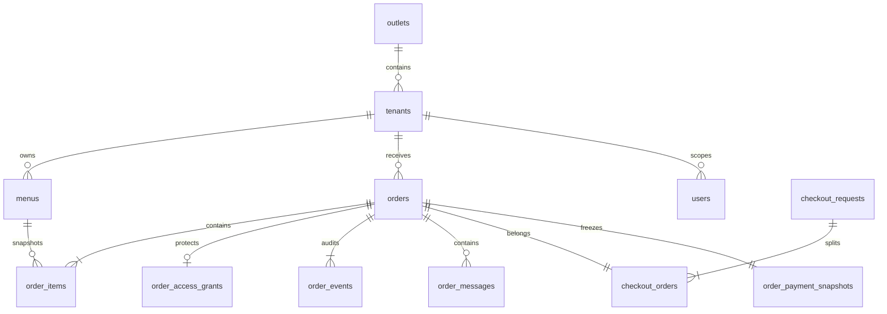

# Model data · DATA-01

**Status:** draft spesifikasi · implementasi SQL lokal tersedia, 2026-11-12.
Schema, migration dan seed sudah dibuat; belum diterapkan ke Supabase live.
Istilah mengikuti [MASTER](MASTER.md). [Panduan instalasi](../infra/supabase/README.md).

## Tabel inti (public)

| Tabel | Kolom utama dan constraint |
|---|---|
| outlets | UUID PK, name, location, floor_map_url nullable, is_active, timestamps |
| tenants | UUID PK, outlet_id FK, name, description, qris_image_url, qris_merchant_name, is_active, timestamps; aktivasi memerlukan merchant + URL HTTPS |
| menus | UUID PK, tenant_id FK, name, price integer positif, photo_url, is_available, is_active, timestamps; UNIQUE(id,tenant_id) |
| orders | UUID PK, tenant_id FK, order_code UNIQUE, customer_name, order_type, total integer positif, status, payment_status, payment_method=qris_static, payment_confirmed_by/at, version, timestamps; UNIQUE(id,tenant_id) |
| order_items | UUID PK, tenant_id, order_id, menu_id, menu_name snapshot, qty, unit_price snapshot, subtotal; UNIQUE(order_id,menu_id); FK komposit ke order/menu |

## Tabel privat (app_private)

| Tabel | Tujuan |
|---|---|
| users | ID=auth.users.id; email, role, tenant_id, is_active; role tenant wajib tenant_id, admin wajib NULL |
| checkout_requests | UUID idempotency_key, SHA-256 request_hash, encrypted response replay, completed_at, expires_at (24 jam) |
| checkout_orders | Mapping checkout ke order tenant; dibuat trigger, FK order deferred |
| order_access_grants | Satu grant per order, SHA-256 token_digest, revoked_at, expires_at; bukan token plaintext |
| order_payment_snapshots | QRIS URL canonical + merchant checkout immutable, FK order deferred |
| order_events | Audit state/order append-only, actual actor, versi, reason, request_id |
| order_messages | Pesan per order dengan pengirim terverifikasi dan urutan server. ID gabungan order dan pesan mendukung retry. RLS hanya untuk pemilik order dan tenant terkait. |
| audit_events | Audit perubahan katalog/profil, scope tenant dan request_id; bukan response API |

Skema privat tidak diekspos Data API. Outlet global tidak diberi tenant_id palsu;
profil admin tenant_id NULL. Tidak ada profil pemesan. Semua 12 tabel ENABLE+FORCE
RLS; Prisma runtime memakai role kantin_api terbatas.

## Integritas dan akses

- Satu order satu tenant; FK komposit menolak menu/order tenant silang.
- Qty 1–99, maksimum 100 baris per order dan 100 order per checkout pada DB.
  Kontrak API membatasi checkout ke 100 menu unik; nominal integer IDR
  per order maksimal Rp1 miliar. Trigger menegakkan subtotal/total aggregate saat commit.
- Harga/nama menu dan QRIS/merchant diambil dari DB saat checkout. Snapshot immutable.
- Status/payment mengikuti OrderSchema shared; trigger menegakkan transisi, audit
  konfirmasi aktual dan optimistic version. Client tidak dapat memalsukan paid.
- Katalog aktif untuk pemesan via API; tenant hanya scope sendiri; admin seluruh kantin.
- Order access token 32 byte random; digest hanya tabel privat. Code saja bukan izin.
- Replay terenkripsi API AES-256-GCM menggunakan key terpisah. Database memeriksa
  envelope berversi; algoritma enkripsi tetap tanggung jawab service Express.
- Soft delete untuk data katalog; hard-delete order ditolak. Audit append-only.
- QRIS diperbarui dengan objek Storage baru, bukan menimpa objek snapshot lama.
- created_at/updated_at UTC; version bertambah server pada mutasi order.

Konteks tepercaya transaction-local, digest lookup, idempotency dan penanganan commit
dijelaskan di [kontrak transaksi API](database-api-context.md). Detail kontrak/alur
fitur tetap pada Feature MD. DTO publik tidak identik dengan row Prisma.

## Data awal dan ekspansi

Seed idempotent memberi satu outlet Kantin Fakultas, satu tenant **nonaktif**, dan
8 menu placeholder. Tidak membuat Auth user/order/payment. Tenant nonaktif hingga
QRIS dan merchant riil lengkap. Nama/harga contoh harus disesuaikan operasional.

Tenant berikutnya ditambah melalui web-admin/API setelah integrasi tersedia,
tanpa tabel per tenant, seed ulang atau deploy. Fixture tenant kedua hanya pada
tes terisolasi; bukan bagian seed operasional.

## Sumber implementasi

- [SQL baseline](../apps/api/prisma/migrations/202611120001_initial/migration.sql).
- [Prisma mapping](../apps/api/prisma/schema.prisma), [seed](../apps/api/prisma/seed.sql).
- [Bundle siap salin](../infra/supabase/setup.sql), [verifikasi](../infra/supabase/verify.sql).
- [Baseline Prisma SQL-first](../apps/api/prisma/README.md).
- [SEC-01](security/rls-and-realtime.md), [hasil tes dan batasnya](database-validation.md).

Prisma tidak menggantikan policy, trigger, publication, FK ke auth.users atau
constraint deferred. Perubahan berikutnya melalui migration SQL yang direview;
jangan memakai db push untuk menimpa baseline. Integrasi Supabase live, multi-koneksi
pool dan delivery Realtime masih belum diuji.
