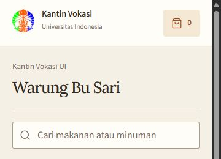
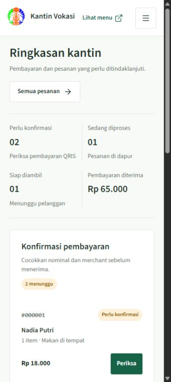

# Penyesuaian logo · 2026-11-14

**Status:** selesai untuk frontend lokal.

- Memakai PNG transparan asli dari pengguna, salinan identik pada kedua aplikasi.
- Emblem proporsional 44px desktop dan 36px HP; tanpa latar, crop atau recolor.
- Nama layanan dan identitas universitas diratakan di sebelah emblem. Sidebar memakai susunan horizontal.
- Guard desain/dokumentasi, lint dan typecheck packages/ui: lulus.
- Browser: pelanggan dan admin pada 360px tidak overflow atau bertabrakan dengan aksi header; gambar termuat dengan ukuran asli 564×592 dan background transparan. Desktop diperiksa pada 1280px.
- Tidak mengubah kontrak API, Auth, database, pesanan atau pembayaran.

