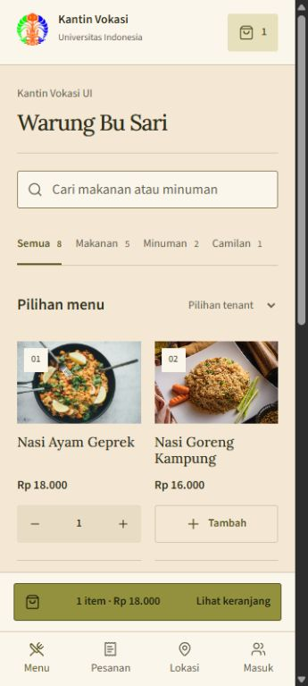
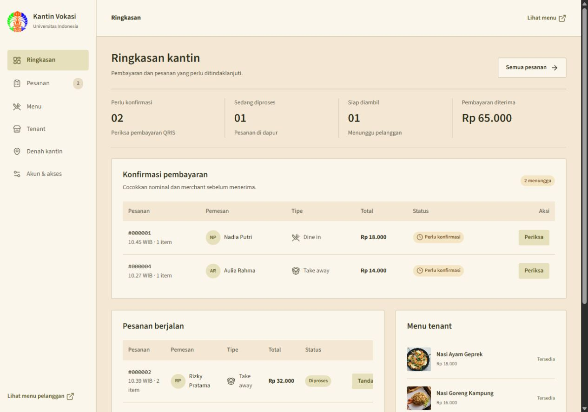
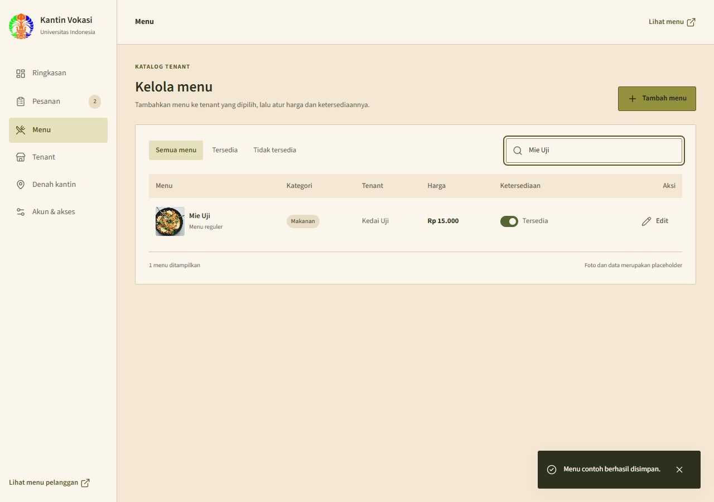

# Palet olive/cream dan akses pengelola · 2026-11-14

**Status:** selesai untuk pratinjau frontend. Acuan ADR-014 pada [MASTER](../MASTER.md).

- Kedua aplikasi memakai olive #93913D untuk tombol/aksen, cream #F4E7D3 sebagai canvas, surface cream terang dan teks gelap. Warna logo asli dipertahankan; favicon mengikuti palet aplikasi.
- Browser mengukur canvas rgb(244,231,211) dan tombol utama rgb(147,145,61) pada kedua aplikasi. Label tombol rgb(32,34,17); link/outline memakai olive gelap.
- Rasio kontras dihitung dari luminansi sRGB: teks tombol/olive 4,90:1; teks link/cream 6,14:1; teks sekunder/cream 4,99:1. Ini pemeriksaan pasangan utama, bukan audit seluruh aksesibilitas.
- Lint/typecheck shared UI dan web-admin serta guard desain/dokumentasi lulus.
- Katalog HP 360px dan panel desktop 1280px tidak overflow dokumen. Tabel menu memakai area scroll sendiri.
- Alur lokal diuji: tambah produk ke keranjang; admin membuat tenant draft Kedai Uji; tambah Mie Uji Rp15.000 dengan memilih Kedai Uji; tabel menunjukkan tenant yang tepat. Reload mengembalikan fixture awal dan membuang data uji lokal.
- Halaman Akun & akses menjelaskan admin dapat menambah tenant/akun tenant dan menu semua tenant, sedangkan tenant hanya menu/pesanan sendiri. Pemilih peran tidak ditambahkan kembali.

## Batas cakupan

Pengujian tenant/menu memakai DemoProvider pada tab uji. Tidak ada email undangan, provisioning Auth, mutasi database, upload Storage, persistensi atau sinkronisasi antaraplikasi. Login staf, profil aktif, RBAC dan scope tenant harus ditegakkan Express sebelum dipakai operasional. Pembaruan ini tidak menutup temuan audit integrasi sebelumnya.

