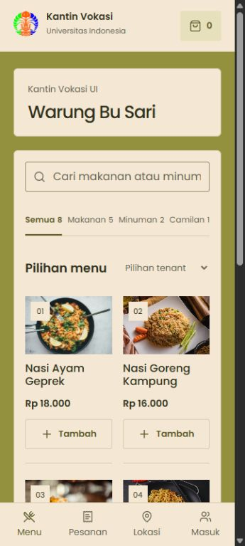
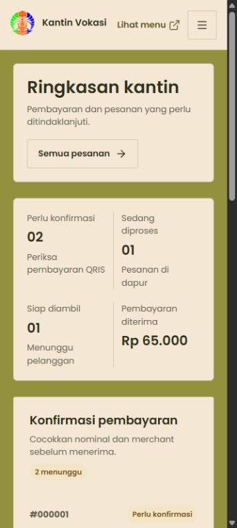
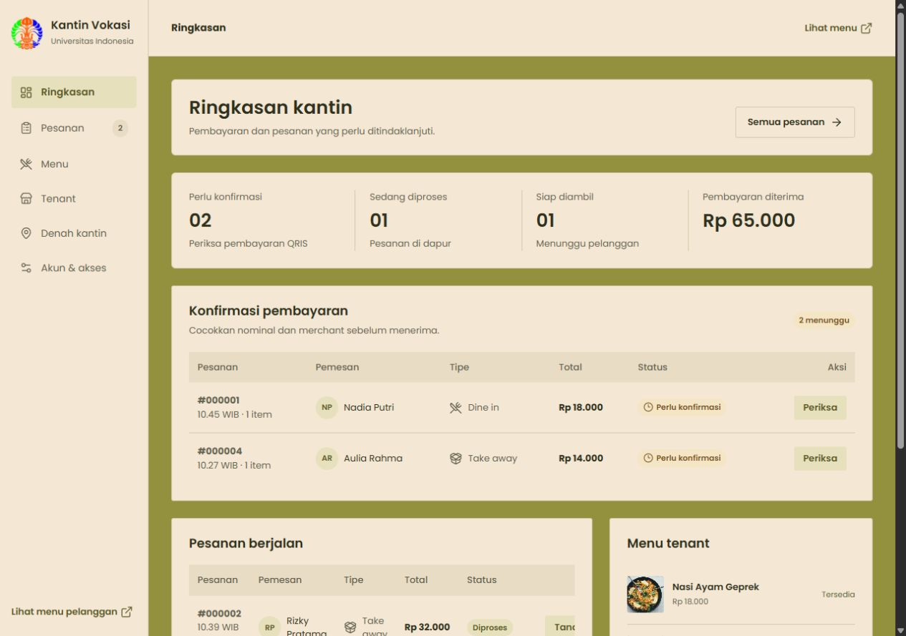

# Poppins · 2026-11-14

**Status:** selesai untuk frontend lokal, ADR-016 pada [MASTER](../MASTER.md).

- Kedua layout Next.js memuat Poppins lokal melalui next/font/local: Regular 400, Medium 500, SemiBold 600, Bold 700, display swap. [Asal dan lisensi](../../packages/ui/fonts/README.md).
- Token body, heading dan angka menggunakan keluarga yang sama; Lora/Source Sans 3 tidak lagi dimuat layout aktif.
- Browser mengukur keluarga Poppins pada body, h1, tombol dan tabel di kedua aplikasi. Palet latar olive/section cream dan logo tetap.
- Pada 360px katalog tidak overflow; kategori clientWidth = scrollWidth = 271px setelah label kategori 12px dan jarak disesuaikan. Header admin tidak lagi membungkus tombol menu ke baris kedua.
- Pada 1280px katalog/admin tidak overflow dokumen. Tabel tetap mempunyai area scroll sendiri bila diperlukan.
- Lint dan typecheck kedua frontend serta guard dokumentasi/desain lulus. Tidak menambah dependency atau mengubah alur bisnis/kontrak data.

