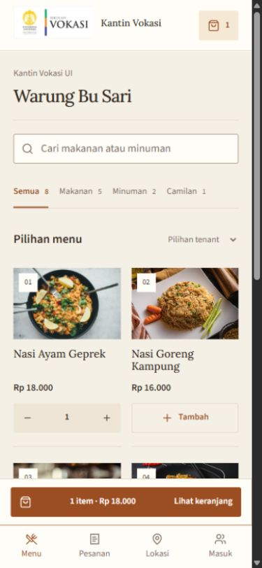
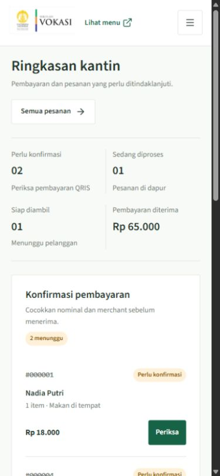
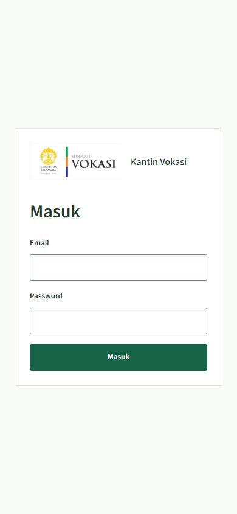
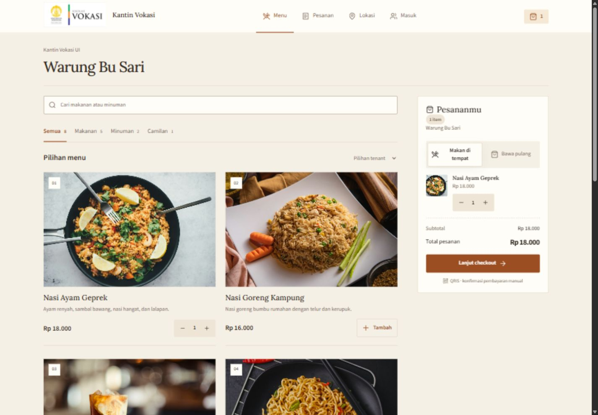
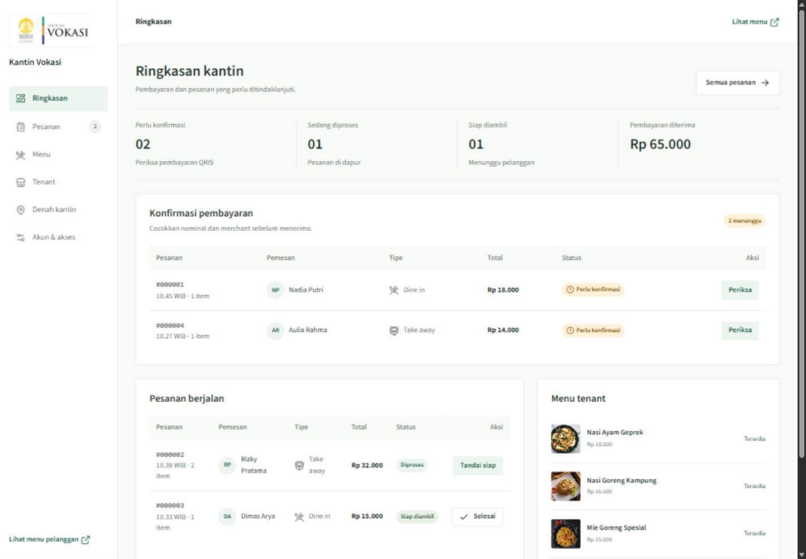

# Validasi revisi tampilan 03

**Tanggal:** 2026-11-13 · **Status:** perubahan frontend lokal, belum produksi.
Acuan: [arah terpilih](../design/revision-03-brief.md), ADR-013 pada [MASTER](../MASTER.md).

## Hasil

- Halaman pelanggan memakai arah B; panel pengelola memakai A.
- Kontrol A/B, peran, ukuran perangkat, slogan dan catatan logo/font/foto di halaman pembanding tidak tampil di aplikasi. Entry review lama mengarah ke katalog.
- Rasio logo 400:168 dipertahankan. Pada HP ukuran terukur 118 × 49,55 px; tidak bertumpuk dengan navigasi.
- Navigasi pelanggan berada di bawah; keranjang persis di atasnya. Panel pengelola HP memakai dialog navigasi dengan focus trap dan restore.
- Viewport 360/390/768/1440: halaman katalog dan ringkasan admin tidak membuat dokumen melebar. Form login hanya email/password.
- Interaksi state lokal diuji: tambah/kurang, filter kategori, pencarian kosong/reset, detail menu dan tutup dialog, navigasi admin ke menu, buka detail pembayaran.
- `pnpm check`: 11 tugas lulus (sebagian cache), termasuk lint dan typecheck. 17 tes shared dan 24 database adalah hasil cache yang sudah lulus, bukan pengujian transaksi live baru.
- Guard dokumentasi dan desain diulang setelah perubahan akhir: lulus.

## Batas cakupan

Login staf tidak memverifikasi Auth/profil karena Express belum tersedia. Submit form menampilkan layanan belum tersedia dan tidak membuka dashboard. URL panel masih pratinjau lokal tanpa guard staf; ini belum menyelesaikan temuan RBAC audit sebelumnya. Jangan deploy sebagai panel operasional.
Role final berasal profil staf aktif di API setelah JWT diverifikasi, bukan user_metadata atau pilihan browser. Seluruh perubahan pesanan/menu/tenant tetap demo per aplikasi, belum persisten/sinkron.

## Build dan lingkungan

Build pertama gagal pada cache Next.js di OneDrive (EPERM unlink direktori reparse). Cache lama dan build parsial dipertahankan di `.local-cache/revision-03` yang diabaikan Git, di luar source aplikasi. Ulang build memakai cache baru di luar sandbox.

## Bukti browser

Hasil build akhir: pnpm build lulus, 3 tugas (2 frontend + shared), setelah cache baru dan eksekusi di luar sandbox. Tidak ada perubahan konfigurasi deploy/DB.
