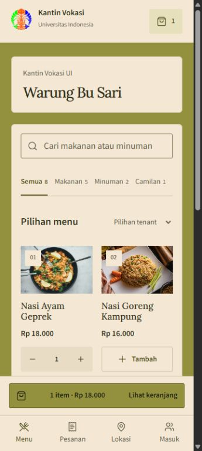
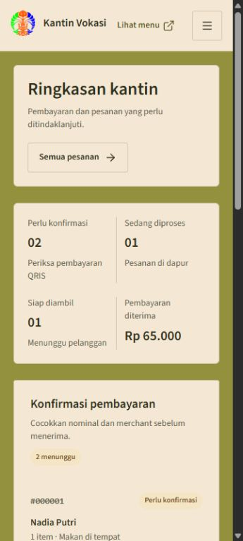
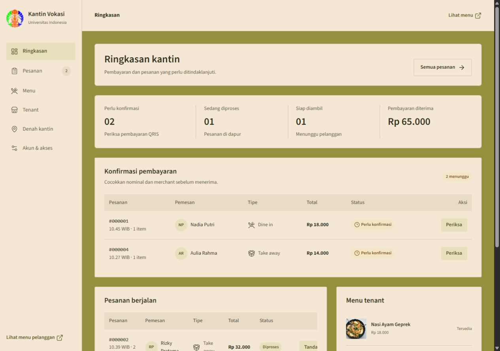

# Latar olive dan section cream · 2026-11-14

**Status:** selesai untuk frontend lokal. Permintaan vendor dicatat pada ADR-015 di [MASTER](../MASTER.md).

- Canvas kedua web #93913D, section/header/sidebar/dialog #F4E7D3. Browser mengukur rgb(147,145,61) dan rgb(244,231,211).
- Judul katalog, area menu, keranjang, judul admin, ringkasan operasional dan form mendapat cream surface dengan padding; jarak luar tetap olive.
- Hover, segmented controls dan tabel memakai cream muted agar canvas olive tidak masuk ke area teks kecil.
- Viewport 360px dan 1280px pada katalog/admin tidak melebar. Kategori HP memiliki clientWidth dan scrollWidth sama (271px), tanpa scrollbar horizontal. Form masuk desktop/HP juga memakai dua section cream.
- Tambah item keranjang diuji pada state lokal. Tidak ada perubahan Auth, API, database atau aturan hak akses.
- Guard desain/dokumentasi, lint dan typecheck packages/ui lulus. Tidak menambah dependency atau tes implementasi kosmetik.

